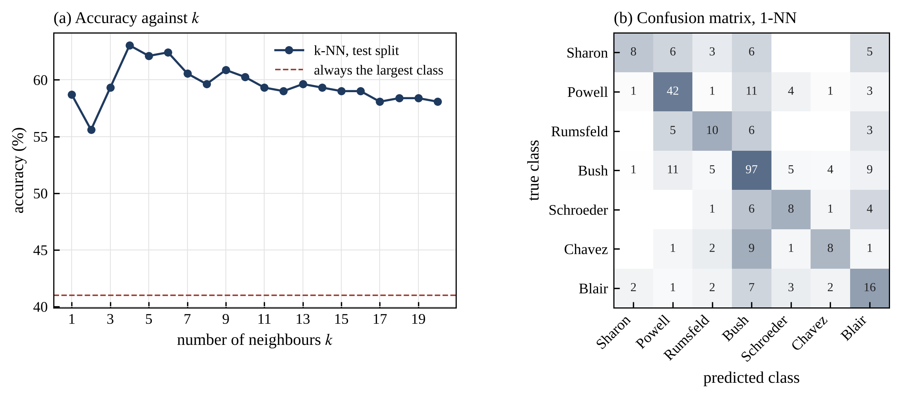

# Lab 1: face recognition with k-nearest neighbours

Classification of face images on raw pixels, scikit-learn. [Back to the overview](../README.md).

- **Tools:** scikit-learn (`KNeighborsClassifier`, `StandardScaler`), NumPy, Matplotlib
- **Data:** Labeled Faces in the Wild, 7 people with at least 70 images: 1288 images of 62 × 47 pixels
- **Result:** **63.0 %** accuracy with 4 neighbours, against 41.0 % when always answering the largest class

## 1. Data and preprocessing

Each image is one vector of 2914 pixels. The split is 966 training images and 322 test images.

| Class | Sharon | Powell | Rumsfeld | Bush | Schroeder | Chavez | Blair |
| --- | --- | --- | --- | --- | --- | --- | --- |
| Images | 77 | 236 | 121 | 530 | 109 | 71 | 144 |

- The mean and standard deviation of each pixel are estimated on the training images only, then applied to both sets.

## 2. 1-NN, then k from 1 to 20



| Classifier | Test accuracy |
| --- | --- |
| Always the largest class | 41.0 % |
| 1-NN, Euclidean distance | 58.7 % |
| **4-NN** | **63.0 %** |
| 20-NN | 58.1 % |

- The classes are unbalanced: 1-NN recall is 73 % for the largest class and 29 % for one of the smallest. Most errors go to the largest class.
- A larger k smooths the decision, then pulls every answer towards the largest class.
- Distances between raw pixels depend on pose and lighting, which limits the accuracy.

## Run

```bash
python 01-knn-face-recognition/knn_faces.py
```
