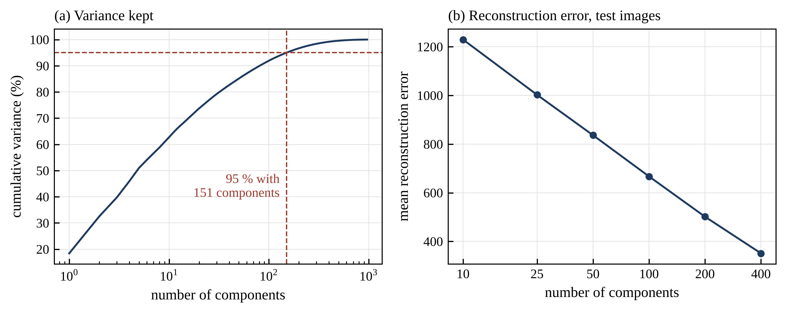

# Lab 2: principal component analysis for classification and compression

PCA on the face images of lab 1, scikit-learn. [Back to the overview](../README.md).

- **Tools:** scikit-learn (`PCA`, `KNeighborsClassifier`), NumPy, Matplotlib
- **Data:** same 1288 face images as lab 1, 2914 pixels each, 966 for training and 322 for test
- **Result:** 100 components give **64.3 %** with 5-NN, against 62.4 % on the 2914 pixels

## 1. Variance kept by the components

The decomposition is fitted on the training images. **151 components** out of 2914 carry 95 % of the variance.



## 2. Classification before and after PCA

5-NN with the Manhattan distance, same split in both cases.

| Input of the classifier | Dimension | Test accuracy | Prediction time |
| --- | --- | --- | --- |
| Pixels | 2914 | 62.4 % | about 540 ms |
| **Principal components** | **100** | **64.3 %** | about 15 ms |

- The components dropped carry mostly noise, so the distance between projected images is more reliable.
- Each distance is computed on 29 times fewer values.

## 3. Compression and reconstruction

Each test image is projected, then rebuilt. The error is the mean Euclidean distance to the original image.

| Components | Size divided by | Variance kept | Reconstruction error |
| --- | --- | --- | --- |
| 10 | 291 | 62.7 % | 1230 |
| 50 | 58 | 85.1 % | 836 |
| 100 | 29 | 91.9 % | 667 |
| 400 | 7 | 99.2 % | 351 |
| Mean image only | — | 0 % | 1997 |

- The error falls slowly: each doubling of the number of components removes 20 to 30 % of it.

## Run

```bash
python 02-pca-compression/pca_faces.py
```
