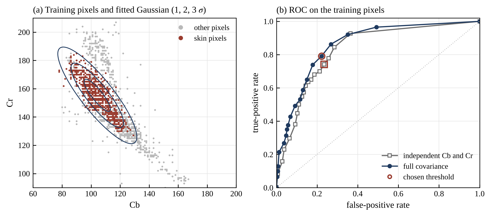

# Lab 3: skin-pixel detection and ROC analysis

One-class Gaussian model of skin colour in the (Cb, Cr) plane, evaluated with a ROC curve. [Back to the overview](../README.md).

- **Tools:** NumPy, SciPy (`norm`, `multivariate_normal`), Pillow, Matplotlib
- **Data:** Pratheepan skin data set (Tan et al., IEEE Transactions on Industrial Informatics, 2012), images with ground-truth masks; 25 images for training, 4 for test, one pixel in 1000 kept
- **Result:** the full-covariance model classifies **82.0 %** of the test pixels, against 76.1 % with independent Cb and Cr

## 1. Likelihood model

Only the skin class is modelled. A pixel is declared skin when its likelihood p(x | skin) is above a threshold.

| Quantity | Value |
| --- | --- |
| Training pixels kept | 4739, of which 26.0 % skin |
| Skin mean (Cb, Cr) | (104.3, 155.3) |
| Skin standard deviation (Cb, Cr) | (9.1, 11.4) |
| Correlation between Cb and Cr | −0.86 |



## 2. ROC curve and operating point

Twenty thresholds between the smallest and the largest training likelihood. The threshold kept is the one where sensitivity and specificity are closest.

| Model | AUC (training) | Sensitivity (test) | Specificity (test) | Accuracy (test) |
| --- | --- | --- | --- | --- |
| Independent Cb and Cr | 0.831 | 96.6 % | 69.0 % | 76.1 % |
| **Full covariance** | **0.859** | 93.2 % | 78.1 % | **82.0 %** |

- Cb and Cr are strongly correlated for skin. The product of two 1-D Gaussians ignores it and accepts a region that is too wide, hence its lower specificity.
- The threshold is set on the training pixels and applied unchanged to the test pixels.

## Run

```bash
python 03-skin-detection-roc/skin_roc.py
```

The script expects the images and their masks in `data/pratheepan/`.
