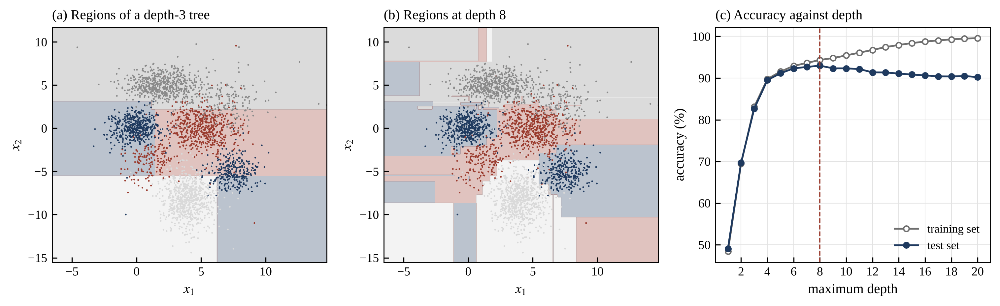
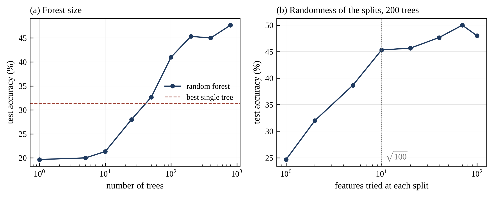

# Lab 4: decision trees and random forests

Effect of the tree depth, then a forest against a single tree on a harder set. [Back to the overview](../README.md).

- **Tools:** scikit-learn (`DecisionTreeClassifier`, `RandomForestClassifier`, `GridSearchCV`), Matplotlib
- **Data:** two course point sets: 2-D with 4 classes (16 640 training points, 4160 test points) and 100-D with 10 classes (700 and 300 points)
- **Result:** on the 100-D set a forest of 800 trees reaches **47.7 %**, the best single tree 31.3 %

## 1. One tree on the 2-D set

Entropy criterion, depth from 1 to 20.



| Maximum depth | Training accuracy | Test accuracy |
| --- | --- | --- |
| 3 | 83.1 % | 82.6 % |
| **8** | 94.3 % | **93.0 %** |
| 20 | 99.6 % | 90.2 % |

- Each split tests one coordinate, so the regions are rectangles with sides parallel to the axes.
- Beyond depth 8 the tree fits isolated training points: the training accuracy keeps rising while the test accuracy falls.
- Precision, recall and F1 of the first class are recomputed by hand from the confusion matrix (0.826, 0.658, 0.732 at depth 3).

## 2. Forest against a single tree on the 100-D set



| Model | Test accuracy |
| --- | --- |
| Best single tree (depth 7) | 31.3 % |
| Forest, 10 trees | 21.3 % |
| Forest, 100 trees | 41.0 % |
| Forest, 200 trees | 45.3 % |
| **Forest, 800 trees** | **47.7 %** |

- With 700 points for 100 features, a single tree depends heavily on its training sample. Averaging many decorrelated trees removes most of that variance.
- A grid search with 5-fold cross-validation on the training set selects 200 trees, depth 10 and 20 features per split: 42.4 % in cross-validation, 47.3 % on the test set.

## Run

```bash
python 04-decision-tree-random-forest/trees_forest.py
```
