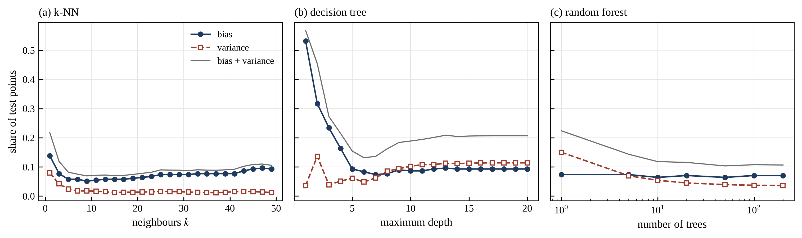

# Lab 5: bias and variance of three classifiers

Bias and variance measured over 30 trainings for k-NN, decision trees and random forests, then a set with one rare class. [Back to the overview](../README.md).

- **Tools:** scikit-learn (`KNeighborsClassifier`, `DecisionTreeClassifier`, `RandomForestClassifier`, `resample`), NumPy, Matplotlib
- **Data:** course 2-D point set, 4 balanced classes, 748 training points and 312 test points; a second set where one class has 18 training points
- **Result:** k-NN has the lowest bias + variance, **0.069 at k = 9**; class weights raise the recall of the rare class from 42 % to 58 %

## 1. Method

Each model is trained 30 times on a random 60 % of the training set. For every test point:

- **bias** is 1 when the most frequent of the 30 predictions is wrong;
- **variance** is the share of the 30 predictions that differ from the most frequent one.

Both are averaged over the test set.

## 2. Results



| Model | Setting | Bias | Variance | Sum |
| --- | --- | --- | --- | --- |
| k-NN | k = 1 | 0.138 | 0.079 | 0.217 |
| **k-NN** | **k = 9** | 0.051 | 0.018 | **0.069** |
| k-NN | k = 49 | 0.093 | 0.012 | 0.105 |
| Decision tree | depth 1 | 0.532 | 0.036 | 0.568 |
| Decision tree | depth 6 | 0.083 | 0.048 | 0.132 |
| Decision tree | depth 20 | 0.093 | 0.114 | 0.207 |
| Random forest | 1 tree | 0.074 | 0.150 | 0.224 |
| Random forest | 50 trees | 0.064 | 0.039 | 0.103 |

- k-NN: a larger k averages more neighbours, which lowers the variance and, beyond k = 9, raises the bias.
- Trees go the other way: a deeper tree has less bias and more variance.
- A forest keeps the bias of its trees and divides the variance by about four between 1 and 50 trees.

## 3. One rare class

Class 0 has 18 training points against about 175 for the others. Random forest of 100 trees.

| Training | Accuracy | Recall of the rare class | Mean recall |
| --- | --- | --- | --- |
| Set as is | 77.0 % | 42 % | 76.8 % |
| Rare class oversampled | 79.7 % | 59 % | 79.4 % |
| **Class weights** | **80.7 %** | 58 % | **80.3 %** |

## Run

```bash
python 05-bias-variance/bias_variance.py
```
