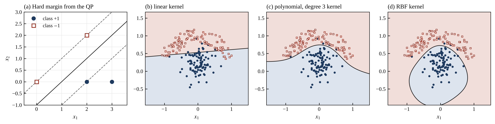

# Lab 6: support vector machines

Hard-margin SVM written as a quadratic program, then soft margin and kernels with scikit-learn. [Back to the overview](../README.md).

- **Tools:** cvxopt (`solvers.qp`), scikit-learn (`SVC`), NumPy, Matplotlib
- **Data:** four hand-placed points, then a course 2-D set of 200 points that is not linearly separable
- **Result:** the QP and scikit-learn give the same separator; the RBF and degree-3 kernels reach **97 %** where the linear one stays at 88 %

## 1. Hard margin as a quadratic program

Minimise ½‖w‖² under yᵢ(w·xᵢ + b) ≥ 1. With z = (b, w), cvxopt solves min ½ zᵀPz under Gz ≤ h, where P is the identity without its first entry, row i of G is −yᵢ(1, xᵢ) and h = −1.

| Solver | w | b | Margin width 2/‖w‖ |
| --- | --- | --- | --- |
| cvxopt QP | (1.000, −1.000) | −1.000 | 1.414 |
| scikit-learn `SVC`, C = 10⁶ | (1.000, −1.000) | −1.000 | 1.414 |



- Three of the four points satisfy the constraint with equality: they are the support vectors. Moving the fourth one does not change the line.

## 2. One more point: hard against soft margin

A fifth point of class +1 is added near the other class.

| Fifth point | Hard margin | Soft margin, C = 1 |
| --- | --- | --- |
| (2.1, 2.5) | Still separable, width falls from 1.414 to **0.080** | Width 2.0, one training error |
| (1.5, 2.5) | **No separating line**: the QP has no solution | Width 1.96, one training error |

- The hard margin follows a single point. The soft margin accepts one error and keeps a wide margin; C sets that trade-off.

## 3. Kernels on a non-separable set

`SVC` with C = 1 on 200 points, one class surrounding the other on one side.

| Kernel | Training accuracy | 5-fold accuracy | Support vectors |
| --- | --- | --- | --- |
| Linear | 88.0 % | 88.0 % | 89 |
| **Polynomial, degree 3** | 97.0 % | **97.0 %** | **25** |
| RBF | 97.0 % | 96.0 % | 43 |

- A curved boundary fits the set, and it needs fewer support vectors than the straight line that cuts through both classes.

## Run

```bash
python 06-svm/svm_margin_kernels.py
```
