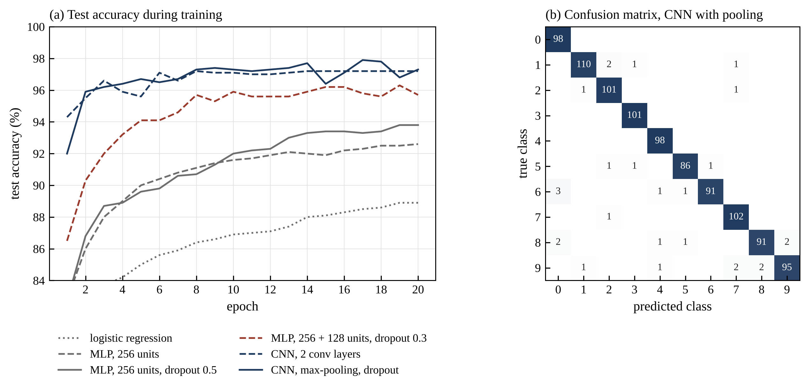

# Lab 7: from logistic regression to a CNN on MNIST

Six networks of growing size trained on the same images, TensorFlow 2 / Keras. [Back to the overview](../README.md).

- **Tools:** TensorFlow 2 / Keras (functional API), scikit-learn for the split and the confusion matrix, Matplotlib
- **Data:** one tenth of MNIST: 6000 training images and 1000 test images of 28 × 28 pixels, scaled to [0, 1], labels one-hot encoded
- **Result:** logistic regression 88.9 %, best MLP 95.7 %, CNN with max-pooling and dropout **97.3 %**

## 1. Networks and training

Softmax output and categorical cross-entropy for all networks, 20 epochs each.

| Network | Parameters | Optimiser | Batch |
| --- | --- | --- | --- |
| Logistic regression | 7850 | SGD, learning rate 0.1 | 256 |
| MLP, 256 units | 203 530 | SGD 0.01, momentum 0.9 | 128 |
| MLP, 256 units, dropout 0.5 | 203 530 | SGD 0.01, momentum 0.9 | 128 |
| MLP, 256 + 128 units, dropout 0.3 | 235 146 | Adam 0.001 | 128 |
| CNN: 32 and 64 filters 3 × 3, dense 256 | 9 458 826 | Adam 0.001 | 128 |
| CNN + max-pooling 2 × 2 + dropout | 2 380 938 | Adam 0.001 | 128 |

- The parameter counts are checked by hand: 784 × 10 + 10 = 7850 for the logistic regression; for the CNN, (3·3·1·32 + 32) + (3·3·32·64 + 64) + (24·24·64·256 + 256) + (256·10 + 10) = 9 458 826.
- 99.8 % of the CNN parameters sit in the first dense layer. Max-pooling halves each side of the feature maps and divides that layer by four.

## 2. Results



| Network | Training accuracy | Test accuracy | Training time |
| --- | --- | --- | --- |
| Logistic regression | 89.3 % | 88.9 % | 3 s |
| MLP, 256 units | 95.6 % | 92.6 % | 6 s |
| MLP, 256 units, dropout 0.5 | 93.8 % | 93.8 % | 7 s |
| MLP, 256 + 128 units, dropout 0.3 | 99.1 % | 95.7 % | 8 s |
| CNN, 2 convolution layers | 100.0 % | 97.2 % | 168 s |
| **CNN, max-pooling, dropout** | 99.3 % | **97.3 %** | 99 s |

- Dropout closes the gap between training and test accuracy of the MLP (3.0 points without, none with).
- The CNN without pooling learns the 6000 training images completely. Pooling and dropout give the same test accuracy with a quarter of the parameters and 40 % less training time.
- Times are for a 2-core CPU.

## Run

```bash
python 07-mlp-cnn-mnist/mnist_networks.py
```
